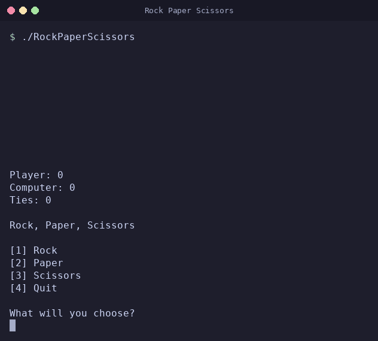

# Rock Paper Scissors Console Game
This application allows the user to play Rock Paper Scissors against the computer. 



*Two real rounds against the computer, then Quit. The pauses are shortened in the recording.*

## Requirements

- `make`
- A C++ toolchain. The `Makefile` invokes `g++`, so a GCC installation that
  includes the C++ compiler driver is what is needed.

## Building

Run `make` from the root of the repository:

```
make
```

The compiled program is written to `RockPaperScissors` in the repository root:

```
$ make
---
Compiling RockPaperScissors
g++ src/RockPaperScissors.cpp -o RockPaperScissors
Finished compiling RockPaperScissors.cpp
```

The build output is removed with `make clean`:

```
$ make clean
---
Removing build output
rm -f RockPaperScissors GameTest
Finished removing build output
```

## Running

```
./RockPaperScissors
```

## Testing

The game's rules live in `src/Game.h` so that they can be linked into a test
binary as well as into the game. `make test` compiles and runs that binary:

```
$ make test
---
Compiling GameTest
g++ src/GameTest.cpp -o GameTest
Finished compiling GameTest.cpp
---
Running GameTest
./GameTest
All GameTest assertions passed.
Finished running GameTest
```

The assertions live in `src/GameTest.cpp` and use `<cassert>`; no third-party
test framework is required. A failing assertion aborts the binary, which fails
the `make test` target with a non-zero exit status.

Some of these assertions are **characterization** tests: they record what the
game does today rather than what it ought to do. `translateChoice` returns
`"scissors"` for every integer outside `1` and `2`, and the suite asserts
exactly that. `translateChoice` is deliberately left total so that no caller
can trip undefined behavior; out-of-range entries are rejected by `readChoice`
before they ever reach it.

### Continuous integration

The `Build` workflow in `.github/workflows/build.yml` runs on every pull request
and every push to `master`. It runs `make` and `make test`, then plays one round
with piped input (an invalid entry, `1`, then `4`) and fails unless the output
contains the rejection message, both moves, exactly one result line, and
`Goodbye!`, with no end-of-input note. A second run pipes only `1`, so the game
reaches the end of its input, and fails unless the output contains exactly one
result line, `No more input to read.`, `Final score` and `Goodbye!`.

## How to Play

The running score is shown at the top of each round, followed by the menu:

```
Player: 0
Computer: 0
Ties: 0

Rock, Paper, Scissors

[1] Rock
[2] Paper
[3] Scissors
[4] Quit

What will you choose?
```

Enter `1`, `2`, or `3` and press Enter. A countdown is printed, both moves are
revealed, and the winner of the round is announced:

```
3!
2!
1!

Shoot!

Player Move: rock
Computer Move: paper
The computer won!
```

The round is paced so that it can be followed: there is a one-second pause
before the countdown, half a second between each number, two seconds between
the moves being revealed and the winner being announced, and four seconds on
the result before the next round's scoreboard is printed. A round therefore
takes about eight and a half seconds, piped input included.

The score is then updated and the next round begins. Rock beats scissors, paper
beats rock, and scissors beats paper; matching moves are counted as a tie.

The computer's move is drawn from a generator seeded from the clock at startup,
so the sequence differs from run to run.

Each line is read as one entry. A line that is anything other than `1`, `2`,
`3` or `4` (surrounding spaces aside) is rejected, and the prompt is repeated.
That includes a number outside that range, text that is not a number at all,
a number written with a sign or leading zeros, such as `+3` or `03`, and a
number with anything else on the line, such as `1abc`, `2.5` or `1 2`:

```
What will you choose?
abc
Please enter 1, 2, 3, or 4.
1abc
Please enter 1, 2, 3, or 4.
```

Blank lines are ignored. Lines ending in a Windows-style `\r\n` are read the
same as lines ending in `\n`.

## Quitting

Enter `4` at the menu to quit. The final score is printed and the program
exits with status `0`:

```
What will you choose?
4

Final score
Player: 1
Computer: 1
Ties: 1

Goodbye!
```

Ctrl+D (end of input) ends a session the same way, with a note that the input
ran out ahead of the final score:

```
No more input to read.

Final score
Player: 0
Computer: 0
Ties: 1

Goodbye!
```

Ctrl+C also works. Piped input behaves like Ctrl+D — the game plays each round
it is given and then exits at the end of the input.

## How the screenshot was captured

`docs/images/rock-paper-scissors.gif` was recorded on 2026-10-18 from a real run of `./RockPaperScissors` built with `make`, with `1`, `3` and `4` typed at the menu. The computer's moves are its own. The program was started in a pseudo-terminal, the input shown was typed into it by a script, and the recorded terminal output was rendered to an image with [pyte](https://github.com/selectel/pyte) and [Pillow](https://python-pillow.org/). Nothing in the output was edited; only the window frame was added. Pauses longer than 1.5 seconds were shortened in the GIF.
